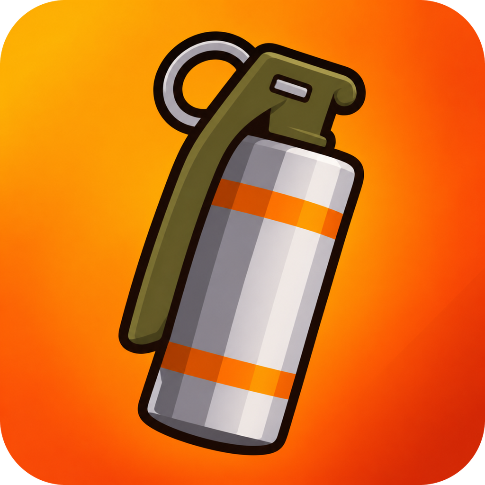

<div align="center">



# CsDraw

**Plan it. Draw it. Replay it.**
A desktop toolkit for Counter-Strike 2: tactical board with grenade stickers, Notion-style playbooks, a media library and a 2D demo viewer, all stored locally in an encrypted vault.


by [splistcs](https://github.com/splistcs)

### NOTE

> **Windows:** the installer is not code-signed, so SmartScreen may show a warning the first time. Choose **More info → Run anyway**.

you may have to disable SmartScreen to use CsDraw, it's sad but necessary :(

</div>

---

## Table of contents

- [Overview](#overview)
- [Download and install](#download-and-install)
- [Features](#features)
  - [Tactical board](#tactical-board)
  - [Playbook](#playbook)
  - [Media](#media)
  - [Demo viewer](#demo-viewer)
  - [Languages and themes](#languages-and-themes)
- [Hotkeys](#hotkeys)
- [Your data and privacy](#your-data-and-privacy)
- [Automatic updates](#automatic-updates)
- [Running from source](#running-from-source)
- [Releasing a new version](#releasing-a-new-version)
- [Images and assets](#images-and-assets)
- [Project structure](#project-structure)
- [Testing](#testing)
- [Changelog](#changelog)
- [Disclaimer](#disclaimer)

---

## Overview

CsDraw has four tabs that work together:

| Tab | What it is for |
| --- | --- |
| **Tactical board** | Draw on any CS2 radar, drop grenade stickers, attach reference images to each one and save the result. |
| **Playbook** | Write strategies in a block editor and embed your drawings, images and videos right in the text. |
| **Media** | A folder-based library for screenshots, lineup clips and any other images or videos. |
| **Demo viewer** | Import `.dem` files and replay the match in 2D with players, utility, kills, a timeline and more. |

Everything is local. Nothing is uploaded anywhere: demos are analyzed on your machine and the results are saved in an encrypted vault that you can export to a single password-protected file.

---

## Download and install

Grab the installer for your system from the [**Releases**](https://github.com/splistcs/CsDraw/releases) page:

| System | File |
| --- | --- |
| Windows | `.exe` installer (NSIS) |
| macOS | `.dmg` / `.zip` |
| Linux | `.AppImage` |

> **Windows:** the installer is not code-signed, so SmartScreen may show a warning the first time. Choose **More info → Run anyway**.
> **macOS:** automatic updates only work with a signed and notarized build (see [Automatic updates](#automatic-updates)).

---

## Features

### Tactical board

- **Map picker** in the header, with an icon for each map. Maps with two levels (Nuke, Vertigo, Baggage) show both radars side by side; the levels button in the toolbar frames *all / upper / lower*.
- **Single toolbar** over the map: move, pen, highlighter, line, arrow, rectangle, ellipse, text, eraser, color, thickness, undo, clear, zoom, fit, **filters** (hide grenade types and/or drawings) and hotkeys.
- **Pan and zoom:** the mouse wheel zooms at the cursor; the *move* tool (or the middle button) drags the map; the zoom percentage resets the framing.
- **Grenade stickers:** drag HE, flash, smoke, molotov, incendiary and decoy onto the map, each with fire, smoke, flash and explosion effects. Dragging a sticker with a drawing tool moves it; double-click removes it.
- **Sticker details:** click a sticker to open the **right-hand drawer**, attach images (button, drag and drop, or `Ctrl+V`) and write a caption for each one.
- **Saved drawings** live in the **left-hand drawer**. Click one to reopen and edit it: **Update** overwrites it, **New** starts another, and you are warned about unsaved changes.
- **Notes** in Markdown, with preview, saved together with the drawing.

### Playbook

A dynamic, **Notion-style block editor** (no separate preview mode: what you type is already formatted). The file is still plain Markdown, autosaved, and **Download .md** exports portable text.

- **Blocks:** text, headings 1–4, bulleted list (with indent / `Tab`), numbered list, to-do list, quote, code block, divider, saved drawing, library image/video and **link (bookmark)**.
- **Block menu:** type `/` (filterable, e.g. `/todo`, `/heading 2`) or click the **`+`** at the left of the line. `↑`/`↓` navigate, `Enter` picks, `Esc` closes.
- **Markdown shortcuts:** `# `, `## `, `- `, `1. `, `[] `, `> `, `---` and fenced code, plus inline `**bold**`, `*italic*`, `~~strike~~` and `` `code` `` as you type. `Ctrl+B/I/E/K` and `Ctrl+Shift+S`; selecting text shows a formatting bar.
- **Reordering:** drag the `⋮⋮` handle (child items move along) or use `Ctrl+Shift+↑/↓`. Click the handle to **duplicate, delete or turn into** another block type. `Ctrl+D` duplicates.
- **Links:** paste a URL on an empty line to get a bookmark card (click opens your browser); with text selected, pasting a URL creates a link. `Ctrl+Z` / `Ctrl+Y` undo and redo.
- Tables and other Markdown without a dedicated block appear as a **Markdown** block (double-click to edit) and are preserved as written.

### Media

A folder explorer for images and videos, with a video player that supports seeking. Import with the button or by dragging files in; drag items onto a folder to move them. Files are stored encrypted in the vault.

Limits: images up to 30 MB, videos up to 8 GB. Accepted formats: PNG, JPG, WEBP, GIF, MP4, WEBM, OGV and MOV (SVG is intentionally not accepted).

### Demo viewer

**Demo library (explorer).** With no demo loaded, the tab shows your library like a file explorer: map thumbnail, scoreboard, teams, **tags**, a **▶ 2D** button, a menu (rename / delete), map filter, search and sorting, grouped by upload day. Drop `.dem` files anywhere on the list (or use **Upload demo**). Analysis is local and the result is saved encrypted, so reopening is instant.

**Full-screen 2D replay**

- Radar with pan and zoom.
- **Team panels** with health, weapon, money, armor and the **grenades each player is carrying**.
- **Round selector** (winner-side color, dotted line at the side switch) and a **timeline** with freezetime, bomb phase, kills and **one colored line per thrown utility** (smoke gray, flash yellow, HE red, molotov/incendiary orange, decoy purple; hover to see who threw it).
- **Player icon on the radar:** health is shown on the body itself (a dark cap at the top grows as health drops), the CT **defuse kit** appears as a badge, **blinded** players get a white ring with the remaining seconds, and the **grenade in hand** is drawn next to the body.
- **Held item:** the marker changes with what the player holds, in the direction they are looking. **Weapon = rectangle** (a longer barrel for pricier weapons: short pistol, medium AK, long AWP/M249), **knife = triangular tip**, **grenade = the grenade icon**.
- **C4:** the bomb carrier gets a C4 badge on the radar and in the panel; a dropped bomb stays on the floor like grenades.

**Animated utility**

- **Smoke and molotov fire spread across the map floor** from where the grenade landed. The floor mask comes from the radar itself, so they do not cross walls.
- A **smoke countdown ring** empties over 18 seconds with the remaining time in the center.
- An **HE that explodes inside a smoke punches a hole** in it (the smoke only parts there, with no outline) that closes after a few seconds.
- **Flash** gives a large, soft halo; **HE** gives a quick orange pulse limited to the affected area.
- Every grenade leaves its **real trajectory** (from the thrower's hand to where it stopped), **blue** if thrown by a CT and **orange** by a T.

**Kill feed and icons**

- The kill feed (top-left, recent kills) mirrors the game: killer, **assister** (with a flash icon for flash assists), **blind**, weapon icon (the specific knife when a PNG exists), **no scope**, **through smoke**, **wallbang** and **headshot**. Kills with no attacker (fall, bomb, world) show just the weapon.
- The panel shows the primary weapon (or pistol) icon next to the name. Missing icons fall back to the weapon name.

**Tools and extras**

- **`setpos`:** hover a player name in the panel to see `setpos x y z;setang pitch yaw 0` for that instant; click to copy (use with `sv_cheats 1`).
- **Annotations** over the map with the same tools as the board (no stickers). They are not saved; `C` clears them.
- **Two levels:** with *split levels* on you see both radars; with it off, one level is framed and `L` toggles between them.
- **Map brightness:** gear icon → *Map brightness* (80–200%, default 125%, remembered).
- **Team names** come from the demo (`team_clan_name`, usual in tournament and scrim matches); otherwise *Team Alpha / Bravo* are used.

<details>
<summary><b>Grenades, C4 and defuse kits on the ground (how it works)</b></summary>

<br>

Two sources, in this order:

1. **The demo's own entities** (`electron/core/demo/WeaponDrops.js`, requires `parseWeapons` from `@laihoe/demoparser2`; update with `npm install @laihoe/demoparser2@latest`). The parser returns, **on every tick of the rounds**, the unowned weapons (position simulated by the server: fall, roll, tumble, plus who dropped them last). Each continuous stay of an entity on the floor is one drop: it appears when dropped (including the grenade dropped on death, the one the game chose), follows the **real path** (`path`: `[seconds since drop, x, y, z]` on every position change, with the exact moment it stops) and disappears on the tick someone picks it up (or stays until the end of the round). Entities without an owner for ≤ 3 ticks, or short and next to a `weapon_fire`, are the weapon vanishing in a throw and do not count. This covers grenades (all of them, if the parser delivered any), C4 and the defuse kit *if they appear in the data* (the kit may not be a weapon entity).
2. **Fallback** (`DropTracker.js` + `DropPhysics.js`), used for what the above does not cover, or for everything if the parser is old, fails or delivers no grenades. It infers drops from `item_remove` / `item_pickup`, deaths and inventory changes, and estimates where the item stops.
   - **Death:** **one single grenade drops, the most expensive in the inventory** (like `mp_death_drop_grenade 1`; incendiary/molotov, smoke, HE, flash, decoy; a smoke/HE tie goes to the smoke, adjustable in `DEATH_GRENADE_PRIORITY`), plus the C4 and kit. The rest vanish with the player. **The defuse kit only drops on death** (the game does not let you drop it).
   - **Dropped on purpose:** every `item_remove` that is not a death, a throw or a round start. **Pickup:** `item_pickup` / `bomb_pickup` close the most plausible drop of the same type.
   - **Where it stops:** a fall/roll model (look direction, player speed) corrected by the picker's position (`DropPhysics.js`); the viewer cuts the path where the radar stops being floor.
   - **Extra reads:** 1 and 6 ticks before each death and `item_remove` (exact inventory and speed).

In the viewer the item follows the `path` (icon height from the real `z`) and disappears at `until`; without a `path`, it slides to `toX/toY`.

To see what the parser delivers for your demo: `npm run inspect-demo -- match.dem --probe` (`parseWeapons` section).

Demos analyzed with an analysis version < 11 are re-analyzed when you upload the file again. The same applies when the demo was read by a **different `@laihoe/demoparser2` version** than the installed one (the reader version is stored in each demo; `ParserVersion.js`). If a demo fails to load, the message says which reader failed and suggests updating CsDraw.

</details>

<details>
<summary><b>Radar calibration and demo notes</b></summary>

<br>

- Radar calibration (`modules/demo-viewer/core/MapCalibration.js`) has official values for Ancient, Anubis, Dust II, Inferno, Mirage, Nuke, Overpass, Train, Vertigo, Office, Italy, Baggage and Shoots. Other maps (and any map whose table misses the floor) are **aligned automatically from the radar image** (`CalibrationFit`: player positions in the demo must fall on the floor), with an *approximate* notice in the settings. If it looks off, use **Auto-fit** or add a row with the values from the game's `overview` file. The height cut between levels is known for Nuke and Vertigo; for Baggage it is estimated from player heights in the demo.
- Compressed `.dem.bz2` demos must be extracted first. Demos up to 3 GB are accepted.
- Demos analyzed with an older format (no inventory, C4, primary weapon, trajectories, blindness, drops or team names) still open but without that data: drop the same `.dem` again and it is re-analyzed in the same record (tags and name are kept).
- To debug a real demo: `npm run inspect-demo -- path/match.dem` (summary) or `-- match.dem --raw` (raw event format). With `-- match.dem --probe` it shows how the parser delivers `inventory`, `pitch`, `team_clan_name`, trajectories (`parseGrenades`), `player_blind` and `item_pickup`.

</details>

### Languages and themes

- **English** (default), **Português (BR)**, **Español** and **Русский**. Switch from the menu next to the theme toggle; your choice is remembered.
- **Dark and light** themes.
- To add another language, create `renderer/src/i18n/locales/<code>.js` with the same keys as `en.js` and register it in `locales/index.js` (`npm test` reports any missing key).

---

## Hotkeys

Press `H` (or the ⌨ button) in any drawing view to see the list in the app.

**Tactical board**

| Key | Action |
| --- | --- |
| `Space` | Clear the drawing (`Ctrl+Z` restores it) |
| `Ctrl+Z` | Undo |
| `D` | Pen (press again to change color) |
| `M` | Move |
| `E` | Eraser |
| `T` | Text |
| `F` | Fit map to screen |
| `+` / `-` | Zoom |
| `H` | Hotkeys list |

**Demo viewer**

| Key | Action |
| --- | --- |
| `Space` | Play / pause |
| `←` `→` | Seek ±5 s (`Shift` 1 s, `Ctrl` 0.1 s) |
| `Shift+↑` / `Shift+↓` | Playback speed |
| `J` / `K` | Previous / next round |
| `D` | Draw |
| `M` | Move |
| `C` | Clear annotations |
| `L` | Toggle level |
| `F` | Include / hide freezetime |
| `Ctrl+Z` | Undo |
| `+` / `-` | Zoom |
| `H` | Hotkeys list |

---

## Your data and privacy

- There is no account or sign-up: the app is local and single-user.
- Everything (library, drawings, playbooks, images, videos and analyzed demos) lives in `<userData>/vault`, **encrypted on disk** with AES-256-GCM in 64 KiB chunks (which allows seeking inside videos without decrypting the whole file).
- The vault key is protected by the OS keychain (Electron `safeStorage`). If the system does not offer one, the key is kept in a local file and the export dialog tells you so.
- **Export** creates a single `.csdraw` file with everything, encrypted with a passphrase of your choice (scrypt + AES-256-GCM, at least 8 characters). **Import** can merge (newest record wins) or replace everything. **Without the passphrase there is no recovery.**
- Electron hardening: `contextIsolation` + `sandbox`, a minimal preload bridge, validated IPC (origin and payload), a strict CSP, a read-only `csdraw-media://` protocol, SVG refused as media and external navigation blocked.
- Plain SQLite does not encrypt the file (that would need SQLCipher, a native module), so CsDraw uses its own encrypted vault instead.

---

## Automatic updates

The installed app checks for a new version about 10 seconds after launch and every 4 hours, downloads it in the background and shows a **Restart and update** banner (if you do not click, it installs when you close the app). The **Updates** link in the header checks immediately. Your data lives in `<userData>/vault`, outside the app folder, and is never touched by an update.

Code: `electron/core/update/UpdateService.js` (+ `ipc/UpdateIpc.js`, `shell/UpdateBanner.jsx`).

**Limits**

- **Windows:** works without a certificate, but the unsigned installer triggers the SmartScreen warning.
- **macOS:** auto-update only works with a **signed and notarized** app (Apple Developer account). Without it the banner offers **Download manually** (opens the releases page).
- **Linux:** only the **AppImage** updates.
- In `npm run dev` / `npm start` (unpackaged app) updates are disabled. `CSDRAW_NO_UPDATE=1` disables them in the installed app too.

---

## Running from source

Requires **Node.js 22+**.

```bash
npm install
npm run dev        # Vite + Electron with hot reload
npm start          # build and open the app
npm test           # core tests (encryption, vault, parser, viewer, i18n)
npm run dist       # build an installer for the current OS into release/
```

| Script | Description |
| --- | --- |
| `npm run dev` | Vite dev server plus Electron with automatic reload |
| `npm run build` | Build the renderer into `dist/` |
| `npm start` | Build and launch Electron |
| `npm test` | Run the `node:test` suite |
| `npm run dist` | Build and package with electron-builder |
| `npm run release` | Build and publish to GitHub Releases (used by CI) |
| `npm run inspect-demo -- <file.dem>` | Inspect how a demo is parsed (`--raw`, `--probe`) |
| `npm run smoke` | Open the real Electron app and exercise it end to end |

---

## Project structure

```
electron/
  main.js, preload.cjs
  app/        ServiceContainer, MainWindow, IpcRegistry, MediaProtocol
  ipc/        Drawing / Playbook / Media / Vault / Demo / Update (one file per area)
  core/       crypto/ vault/ transfer/ demo/ update/ validation/ errors/   (no Electron dependency)
renderer/src/
  shell/      header, tabs, navigation, export/import, update banner
  shared/     api, constants, drawing engine, markdown, ui
  modules/    board/  playbook/  media/  demo-viewer/   (each tab is independent; registered in modules/index.js)
  i18n/       provider, language select and locales (en, pt-BR, es, ru)
build/        app icons
test/         node:test (core, viewer and i18n)
scripts/      inspect-demo.mjs, electron-smoke.mjs
```

The demo viewer only depends on `window.csdraw.demo` and utilities from `shared/`; to remove it, delete its line in `modules/index.js` and its folder.

---

## Testing

- `npm test` runs the `node:test` suite (encryption, vault, transfer, demo analysis, drop physics, viewer logic, markdown editor, updates and i18n key parity).
- `scripts/electron-smoke.mjs` opens the real Electron app (on Linux: `xvfb-run -a npm run smoke` with `SMOKE_DATA=/tmp/data`), exercises IPC, the media protocol, the sticker menu, playbooks, media, the demo viewer (with a synthetic demo) and export/import, and saves screenshots.

---

## Changelog

### 1.0.1

- New app icon (rounded, transparent corners) for the installer, the window and the favicon.
- New header branding: the grenade icon next to **CsDraw**, with a subtle *by splistcs* tag.
- **English is now the default language**; Português (BR), Español and Русский remain available from the language menu. Messages coming from the main process are in English as well.
- Source code cleaned of comments.
- Asset notes renamed to `README.txt` and translated.

### 1.0.0

- First release: tactical board, playbooks, media library, 2D demo viewer, encrypted vault with export/import and automatic updates.

---

## Disclaimer

CsDraw is an independent community project. Counter-Strike and Counter-Strike 2 are trademarks of Valve Corporation. This project is not affiliated with or endorsed by Valve.
